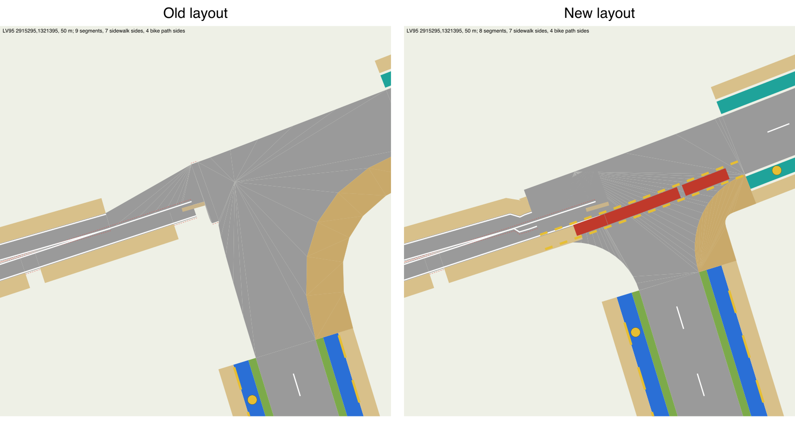
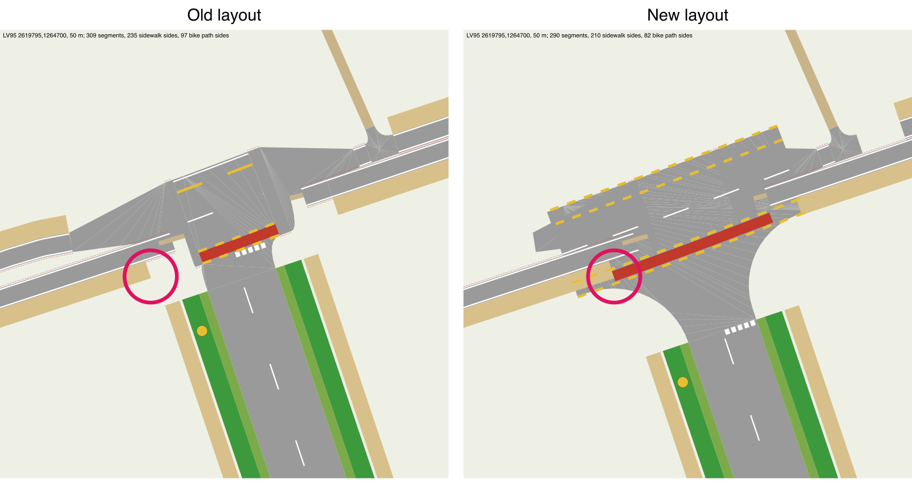
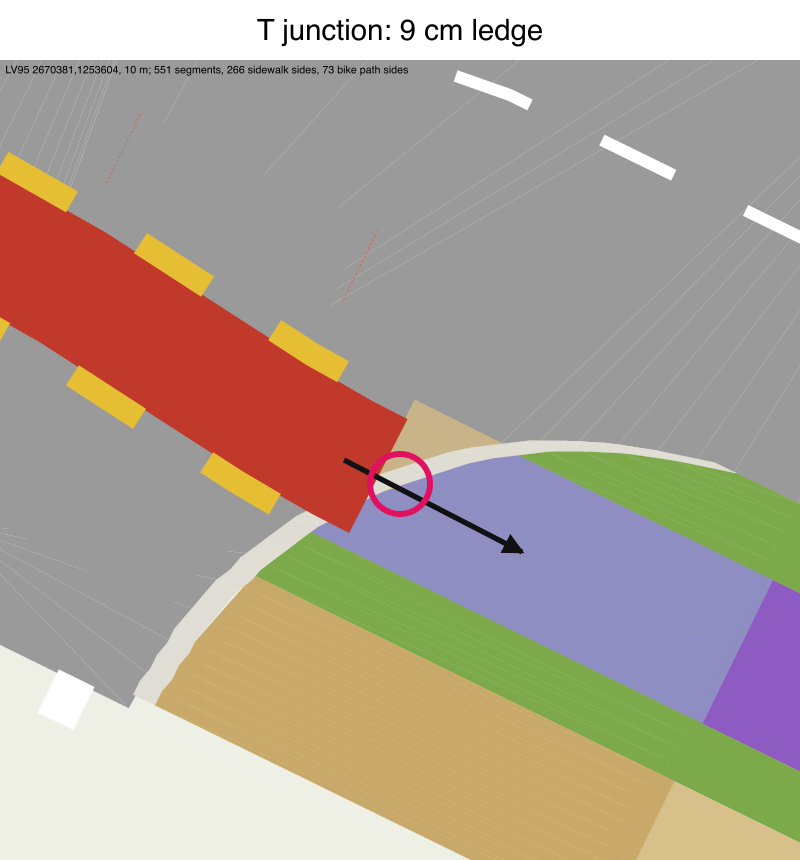

> [!NOTE]
> This file was fully generated by Claude.

# Junction edge cases (#818)

Real junctions too odd to settle a layout rule on. Each is kept for a later look (a phase, or a cleaner example built in the
test region), not fixed one by one. Add one with: where (LV95 and tile), what is odd, what the new layout does there,
what is still open, and a render (`RoadGen --street-svg E,N --size 50 --chunks DIR --svg FILE`).

| Where (LV95) | Tile | What is odd | New layout there | Open |
|---|---|---|---|---|
| 2619795,1264700 | 2619_1264 | A side road joins a main road from the south; 6 m west of the T the main road divides into two 2.2 m carriageways (richtungsgetrennt) joined at their start by a 1.5 m link: the "minor street" beside it was the southern carriageway. Rebuilt in the test region as it is (`DividedTeeE`).  | The core, sized for its turns, reaches over the minor street's end: the main road's bike crossing (red) runs over that street's sidewalk (kerb check: a 7 cm step, cap to side Sidewalk at 2619786.8,1264697.5). The old cap stopped short of it. | The user (Oct 14 2026): "pretty much broken, too many issues to decide yet". **Settled (Oct 15):** a road joining an arm short of its mouth leaves the junction to the old layout until phase 5.  |
| 2670385,1253605 | 2670_1253 | A T where lanes and tracks (no car arms of the junction) meet the main road beside it. | The main road's path crossing ends on the core's kerb right where such a lane's ribbon meets the core 9 cm below the core's edge: the carried path's sloped strip stands on the core, the lane under it is lower (kerb check: a 14 cm step, carriageway to area BikePath at 2670381.0,1253603.7). The corner there is not built (it would overlap a road). | **Settled (Oct 15):** its lane arm's first link ends 7 m out where tracks join: a road joining short of a mouth, so the old layout until phase 5. The test region's `ShortArmE` T showed a trim bug on the way (fixed).  |
